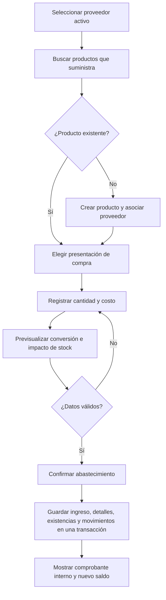
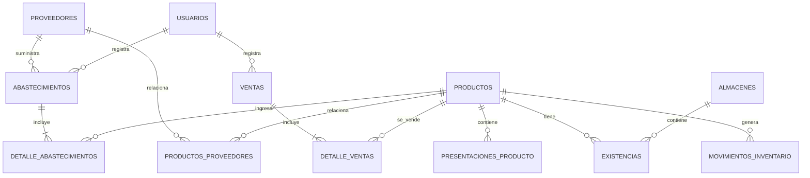
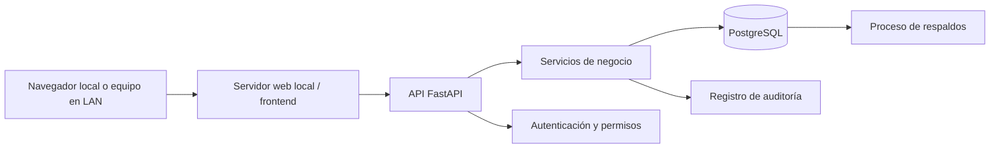

# SIV · Almacén Vivo
## Plan maestro de diseño y desarrollo de un sistema web local de inventario, proveedores, abastecimiento y ventas

> **Versión del documento:** 1.0 · **Fecha:** 08/11/2026  
> **Estado:** Especificación de proyecto propuesta, lista para convertir en tareas de desarrollo.  
> **Tipo de solución:** aplicación web local, sin dependencia de Internet para operar.  
> **Negocio objetivo:** tienda de abarrotes y productos de consumo general.  
> **Escala inicial:** 1 computadora, 1 almacén y entre 1 000 y 10 000 productos.  
> **Escala futura:** varios usuarios y equipos conectados por red local.  
> **Tecnologías recomendadas:** React + TypeScript, FastAPI y PostgreSQL.

---

## Índice

1. [Visión y objetivos](#1-visión-y-objetivos)
2. [Experiencia de usuario: una interfaz intuitiva y poco común](#2-experiencia-de-usuario-una-interfaz-intuitiva-y-poco-común)
3. [Mapa de pantallas y navegación](#3-mapa-de-pantallas-y-navegación)
4. [Flujos operativos esenciales](#4-flujos-operativos-esenciales)
5. [Alcance funcional por módulos](#5-alcance-funcional-por-módulos)
6. [Reglas críticas de negocio e inventario](#6-reglas-críticas-de-negocio-e-inventario)
7. [Modelo de datos propuesto](#7-modelo-de-datos-propuesto)
8. [Arquitectura tecnológica](#8-arquitectura-tecnológica)
9. [API y contratos de integración](#9-api-y-contratos-de-integración)
10. [Plan de desarrollo por fases](#10-plan-de-desarrollo-por-fases)
11. [Pruebas, rendimiento y criterios de calidad](#11-pruebas-rendimiento-y-criterios-de-calidad)
12. [Seguridad, respaldo y recuperación](#12-seguridad-respaldo-y-recuperación)
13. [Instalación y operación local](#13-instalación-y-operación-local)
14. [Versiones y ampliaciones futuras](#14-versiones-y-ampliaciones-futuras)
15. [Riesgos y decisiones de diseño](#15-riesgos-y-decisiones-de-diseño)
16. [Entregables y definición de terminado](#16-entregables-y-definición-de-terminado)
17. [Primer incremento funcional recomendado](#17-primer-incremento-funcional-recomendado)

---

# 1. Visión y objetivos

## 1.1. ¿Qué se va a construir?

**SIV · Almacén Vivo** será una aplicación web local para gestionar el ciclo completo de la mercadería:

**Proveedor → Abastecimiento → Existencias → Venta → Movimiento auditado → Reporte.**

El usuario podrá registrar productos, identificar quién los suministra, recibir mercadería en cajas, sacos, paquetes o fracciones, vender desde una pantalla tipo caja rápida y consultar el stock sin realizar cálculos manuales. Cada ingreso o venta confirmado cambiará las existencias de manera automática y consistente.

La aplicación se ejecutará en la computadora del negocio. Se accederá desde un navegador a una dirección local como `http://localhost:8080`. No se necesitará Internet para registrar productos, entradas, ventas ni reportes. **Sin embargo, la computadora anfitriona sí debe permanecer encendida para que futuros equipos de la red local puedan conectarse.**

## 1.2. Problemas que debe resolver

| Problema habitual | Respuesta del sistema |
|---|---|
| No saber cuánto stock queda | Existencias actualizadas por cada operación confirmada. |
| Ingreso lento de mercadería | Recepción basada en proveedor y productos habituales. |
| Comprar por caja y vender por unidad | Conversión automática a una unidad base. |
| Vender 0,25 kg, 0,5 L u otras fracciones | Cantidades decimales y equivalencias exactas. |
| Perder el origen de los productos | Historial de abastecimientos por proveedor. |
| No recordar el último costo | Historial de costos por proveedor y presentación. |
| Duplicar una venta por error | Confirmación idempotente y bloqueo de operaciones repetidas. |
| No entender por qué cambió el stock | Línea de tiempo explicativa del producto. |
| Buscar entre miles de artículos | Búsqueda por nombre, código, categoría y código de barras. |
| Tener que rehacer el sistema al crecer | Diseño multiusuario y preparada para varias estaciones. |

## 1.3. Objetivos verificables

1. Gestionar un catálogo inicial de **1 000 a 10 000 productos**, con búsqueda y filtros ágiles.
2. Registrar cada abastecimiento normal **a partir de un proveedor seleccionado**.
3. Registrar **ventas simples** y descontar las existencias automáticamente.
4. Manejar unidades múltiples y fraccionadas **sin duplicar artificialmente el stock**.
5. Mantener historial de costos, precios, movimientos y responsables.
6. Operar localmente sin Internet ni dependencias en servicios externos.
7. Permitir incorporar nuevas computadoras y usuarios sin reescribir el núcleo.
8. Priorizar una interfaz que se entienda **por tareas**, no por estructuras de base de datos.

## 1.4. Alcance excluido de la primera versión

No se incluirán en V1: facturación electrónica SUNAT, contabilidad completa, cuentas por cobrar, crédito, comercio electrónico, órdenes de compra formales, transferencias entre almacenes, integración con balanzas ni seguimiento avanzado de lotes y vencimientos. La arquitectura dejará puntos de extensión para incorporarlos posteriormente. **Los comprobantes emitidos en V1 serán internos y no sustituirán los comprobantes tributarios exigibles.**

---

# 2. Experiencia de usuario: una interfaz intuitiva y poco común

> **Concepto rector:** «Menos sistema administrativo, más mesa de trabajo». No copiar un panel ERP genérico con decenas de opciones, tarjetas redundantes o formularios interminables.

El diferenciador del producto no será únicamente el color o el estilo visual. Será la **manera de trabajar**: acciones visibles, pocos pasos, información contextual y una explicación inmediata de lo que cambiará cuando se confirme una operación.

## 2.1. Tres estaciones de trabajo

La navegación principal se organizará en tres estaciones grandes, fáciles de reconocer:

| Estación | Pregunta que responde | Acción principal | Usuarios típicos |
|---|---|---|---|
| **VENDER** | «¿Qué está comprando el cliente?» | Crear y confirmar una venta. | Vendedor, administrador. |
| **RECIBIR** | «¿Qué llegó y de quién?» | Registrar mercadería de un proveedor. | Administrador; almacenero futuro. |
| **EXPLORAR** | «¿Qué tengo, cuánto queda y qué ocurrió?» | Buscar productos, existencias e historial. | Todos según permisos. |

En una banda secundaria, menos prominente, estarán **Analizar** (reportes), **Gestionar** (productos y proveedores) y **Administrar** (usuarios, copias de seguridad, configuración). Esto permite mantener el acceso a todas las funciones sin convertir el menú en una lista interminable.

### Principios de interfaz

- **Una pantalla, una intención principal.** La acción relevante debe entenderse en menos de una mirada.
- **Acción antes que menú.** Al abrir SIV, mostrar «Nueva venta», «Recibir mercadería» y «Buscar producto» en lugar de un tablero saturado.
- **Explicación antes de confirmar.** Ver «+240 unidades» o «−750 g» antes de guardar.
- **Contexto sin perder la tarea.** Usar paneles laterales para consultar detalles sin cerrar una venta o recepción.
- **Progresión visible.** Formularios largos se dividen en pasos claros con avance legible.
- **Doble velocidad.** Interfaz evidente para principiantes y atajos de teclado para usuarios frecuentes.
- **Datos que cuentan una historia.** Las existencias tienen una «huella» cronológica; no son solo una cifra.
- **Sin sorpresas destructivas.** Guardar, confirmar, anular y corregir son acciones diferentes, con consecuencias explicadas.

## 2.2. Identidad visual diferencial

### Propuesta estética: «editorial de mercado»

Una interfaz cálida y moderna, inspirada en etiquetas comerciales, fichas de almacén y señalética, sin parecer una hoja de cálculo ni un ERP tradicional. Utilizar tipografía amplia para las acciones, numerales destacados para cantidades, bordes finos y espacios generosos. Los colores deben comunicar estado y sección, pero nunca ser el único indicador.

| Token visual | Propuesta inicial | Uso |
|---|---|---|
| `--canvas` | `#F7F5F0` | Fondo cálido de la aplicación. |
| `--ink` | `#192A31` | Texto principal y contraste. |
| `--surface` | `#FFFFFF` | Paneles, formularios y listados. |
| `--brand` | `#146C65` | Acciones primarias y navegación. |
| `--accent` | `#E1F29A` | Énfasis en acciones de alta frecuencia. |
| `--warning` | `#98630A` | Alertas de stock, advertencias. |
| `--danger` | `#B63E35` | Errores y acciones de reversión. |
| `--muted` | `#617277` | Información secundaria. |

La paleta es una **propuesta**, no una decisión irreversible. Se validará la legibilidad antes de implementarla. Tipografía preferida: una familia sans moderna instalada o distribuida **localmente**; números tabulares para cantidades, precios y totales. No descargar fuentes desde Internet mientras se utiliza el sistema.

### Elementos de marca propios

1. **Barra de pulso:** franja superior pequeña que indica «Servidor local conectado», usuario activo y última operación.
2. **Tarjeta de operación:** cada venta o recepción se construye en un área central con un único botón primario.
3. **Cinta de impacto:** antes de confirmar muestra exactamente qué stock cambiará y en qué cantidad.
4. **Huella del producto:** historial vertical de abastecimientos, ventas, costos y ajustes autorizados.
5. **Radar de reposición:** sección visual que ordena productos por urgencia de reposición y no solo por unidades restantes.
6. **Buscador universal:** una sola entrada para encontrar productos, proveedores u operaciones, con resultados claramente separados.

La interfaz debe verse distintiva **sin incorporar animaciones decorativas que ralenticen el punto de venta**.

## 2.3. Pantalla inicial orientada a tareas

```text
┌───────────────────────────────────────────────────────────────────┐
│ SIV · ALMACÉN VIVO               ● Local conectado      Usuario ▾ │
├───────────────────────────────────────────────────────────────────┤
│                                                                   │
│  Buenas tardes. ¿Qué necesitas hacer?                             │
│                                                                   │
│  ┌───────────────────┐ ┌───────────────────┐ ┌───────────────────┐ │
│  │  VENDER           │ │  RECIBIR          │ │  EXPLORAR         │ │
│  │  Nueva venta  →   │ │  Nuevo ingreso →  │ │  Buscar stock →   │ │
│  └───────────────────┘ └───────────────────┘ └───────────────────┘ │
│                                                                   │
│  HOY EN LA TIENDA                         ATENCIÓN NECESARIA      │
│  Ventas: S/ 1 850  ·  37 operaciones       8 productos agotados   │
│                                            14 por reponer         │
│                                                                   │
│  ACTIVIDAD RECIENTE                                                │
│  16:42 Venta #0142         − 3 productos                           │
│  16:21 Ingreso #0038       + 12 productos                          │
│                                                                   │
│  Ver reportes  ·  Gestionar productos  ·  Proveedores              │
└───────────────────────────────────────────────────────────────────┘
```

Los números mostrados son ilustrativos; la aplicación mostrará cifras reales. En los primeros usos, el inicio ofrecerá un recorrido guiado compacto, que podrá omitirse.

## 2.4. Pantalla VENDER: rápida y distinta a un formulario administrativo

```text
┌───────────────────────────────────────────────────────────────────┐
│ ← Inicio     VENDER · Venta nueva          Venta #en preparación  │
├──────────────────────────────────────┬────────────────────────────┤
│ Buscar nombre / código / escanear    │ TU VENTA                   │
│ [ Arroz cost...                  ⌕ ] │                            │
│                                      │ Arroz a granel              │
│ Resultados                           │ 0,750 kg × S/ 5,00   S/3,75│
│ ┌──────────────────────────────────┐ │                            │
│ │ Arroz a granel                   │ │ Leche entera              │
│ │ Disponible: 42,500 kg            │ │ 2 und × S/ 4,50      S/9,00│
│ │ Vender por: kg ▾                 │ │                            │
│ │ Cantidad: [ 0,750 ]  [Agregar]   │ │ ───────────────────────── │
│ └──────────────────────────────────┘ │ TOTAL               S/12,75│
│                                      │                            │
│ [F3] Buscar   [Esc] Limpiar          │ [ CONFIRMAR VENTA ]        │
├──────────────────────────────────────┴────────────────────────────┤
│ IMPACTO: arroz −750 g · leche −2 unidades. Stock validado.        │
└───────────────────────────────────────────────────────────────────┘
```

**Diferenciador:** el vendedor ve tanto el precio como el impacto real en inventario. Si elige una caja, el sistema presenta «1 caja = 24 unidades». Si vende una fracción, ve la equivalencia exacta.

### Microinteracciones útiles

- Una búsqueda conserva el foco al agregar un producto, para continuar escaneando.
- Los resultados muestran **nombre, presentación y stock**, no solo una lista de títulos.
- El usuario puede editar una línea del carrito sin rehacer la venta.
- Cambios de cantidad actualizan el total sin confirmar todavía el stock.
- Durante el guardado el botón se bloquea y aparece «Registrando venta…».
- La confirmación devuelve número de venta y opciones «Nueva venta» / «Ver detalle».
- Si el stock cambió por otra operación, se muestra el nuevo saldo y se solicita ajustar la cantidad; nunca se vende stock inexistente.

## 2.5. Pantalla RECIBIR: trabajar desde el proveedor

```text
┌───────────────────────────────────────────────────────────────────┐
│ ← Inicio       RECIBIR MERCADERÍA                    Paso 2 de 3   │
├───────────────────────────────────────────────────────────────────┤
│ Proveedor: Distribuidora ABC                         [Cambiar]     │
│ Documento: [F001-00123 ]    Fecha: [08/11/2026]                  │
│                                                                   │
│ SUS PRODUCTOS HABITUALES                  Buscar otro producto ⌕  │
│ ┌───────────────────────────────────────────────────────────────┐ │
│ │ Aceite 900 ml   Caja × 12   [5] cajas    [S/100,80] [Añadir]  │ │
│ │ Leche 400 g     Caja × 24   [8] cajas    [S/ 84,00] [Añadir]  │ │
│ └───────────────────────────────────────────────────────────────┘ │
│                                                                   │
│ RESUMEN: 13 cajas · 2 productos · Costo S/ 1 176,00               │
│ IMPACTO: aceite +60 und · leche +192 und                           │
│                                     [Volver] [Revisar y confirmar]│
└───────────────────────────────────────────────────────────────────┘
```

La secuencia será **1. Proveedor → 2. Productos → 3. Revisar y confirmar**. Un producto nuevo podrá crearse en una ventana lateral y añadirse sin perder el abastecimiento en curso.

## 2.6. Pantalla EXPLORAR: stock explicable

Al consultar un producto, además de la cifra actual se abrirá una **ficha viva** con:

- Existencia actual, unidad base y equivalencias fáciles de leer.
- Precio de venta por presentación, costo medio y último costo.
- Proveedores conocidos y última compra de cada uno.
- Stock mínimo y estado de reposición.
- **Huella:** entradas, ventas, anulaciones y ajustes, ordenados cronológicamente.
- Un enlace «¿Cómo se calculó este saldo?» que suma los movimientos confirmados.

Evitar que la ficha obligue al usuario a abandonar el listado; se mostrará en un panel lateral, con opción de vista completa.

## 2.7. Accesibilidad y usabilidad que no se negocian

- Objetivo de contraste mínimo WCAG AA para texto habitual; validar combinaciones reales.
- No usar el color como única señal: incluir palabras como «Bajo», «Agotado» o «Disponible».
- Tamaños de clic cómodos y navegación completa con teclado.
- Estados claros: vacío, cargando, error, sin permisos, confirmación exitosa.
- Modales accesibles y foco recuperado correctamente al cerrarlos.
- Atajos configurables sin depender de teclas reservadas del navegador.
- Preferencia de movimiento reducido; transiciones discretas.
- Diseñar primero para escritorio (aprox. 1366 × 768 en adelante) y conservar usabilidad en tablet; móvil es secundario en V1.
- Fechas en formato local, moneda `S/`, números decimales coherentes con la configuración regional peruana.
- Textos comprensibles: «Recibir mercadería», no «Crear transacción de entrada».

---

# 3. Mapa de pantallas y navegación

La arquitectura de información combina acceso **por tarea** y herramientas de **administración**.

```text
INICIO · ¿Qué deseas hacer?
│
├── VENDER
│   ├── Nueva venta (principal)
│   ├── Historial de ventas
│   └── Detalle y anulación autorizada
│
├── RECIBIR
│   ├── Nuevo abastecimiento (seleccionando proveedor)
│   ├── Historial de abastecimientos
│   └── Detalle y reversión autorizada
│
├── EXPLORAR
│   ├── Buscar productos / existencias
│   ├── Ficha viva del producto
│   ├── Historial de movimientos (kardex)
│   └── Radar de reposición
│
├── GESTIONAR
│   ├── Catálogo de productos
│   ├── Categorías y marcas
│   ├── Unidades y presentaciones
│   ├── Proveedores
│   ├── Productos por proveedor
│   └── Importación desde Excel
│
├── ANALIZAR
│   ├── Ventas
│   ├── Abastecimientos por proveedor
│   ├── Valor y estado de inventario
│   ├── Costos y margen bruto
│   └── Exportación Excel / PDF
│
└── ADMINISTRAR
    ├── Usuarios y roles
    ├── Configuración general
    ├── Auditoría
    ├── Copias de seguridad
    └── Diagnóstico del servidor local
```

### Búsqueda universal

Una acción visible en cabecera, con sugerencia de atajo (`Ctrl + K` como propuesta), permitirá buscar rápidamente un producto, proveedor, venta o ingreso. Los resultados siempre se agruparán por tipo para evitar confusión. Un buscador universal **no reemplaza** los filtros específicos de las tablas.

### Navegación sin pérdida de trabajo

Al intentar abandonar una venta o un abastecimiento con datos no confirmados se mostrará una advertencia clara. Se podrá guardar un borrador **local y temporal**, si se incluye esa funcionalidad, pero un borrador nunca alterará las existencias.

---

# 4. Flujos operativos esenciales

## 4.1. Primera puesta en marcha

1. Instalar y activar los componentes locales.
2. Crear el usuario administrador.
3. Crear o confirmar el almacén inicial.
4. Definir moneda y preferencias de formato.
5. Registrar categorías, unidades y presentaciones generales.
6. Registrar proveedores.
7. Importar productos desde una plantilla de Excel o registrarlos manualmente.
8. Revisar duplicados, equivalencias y precios.
9. Registrar el **inventario inicial** mediante una operación administrativa especial.
10. Ejecutar una compra de prueba y una venta de prueba en un entorno de validación antes de operar con datos reales.

**Nota:** el inventario inicial no es una compra ficticia. Debe quedar diferenciado de los ingresos de proveedores.

## 4.2. Alta de proveedor y abastecimiento



El proveedor será **obligatorio en abastecimientos normales**. Un mismo producto podrá tener muchos proveedores. La recepción guardará el costo efectivamente registrado, incluso si difiere de compras anteriores.

## 4.3. Venta simple

1. Buscar o escanear el producto.
2. Elegir presentación de venta: unidad, paquete, caja, kg, g, litro, etc.
3. Escribir cantidad y añadir al carrito.
4. Ver el total y el impacto sobre las existencias.
5. Confirmar la venta.
6. El servidor valida nuevamente stock y permisos.
7. La base de datos guarda la venta, sus líneas, el costo histórico y la salida de inventario en una misma transacción.
8. Mostrar resultado y dejar lista la siguiente venta.

El sistema **no hará una salida independiente** para una venta. La salida formará parte del procesamiento de la propia venta.

## 4.4. Anulación o corrección de una venta

- Solo un usuario autorizado puede anular una venta confirmada.
- La venta original permanece con estado `anulada`; no se borra.
- Se registran movimientos reversos que restituyen las existencias correspondientes.
- Se evita anular dos veces la misma venta.
- Se guarda fecha, usuario y motivo.
- Si hubo operaciones posteriores, el historial permanece cronológicamente íntegro.

## 4.5. Ajuste excepcional de inventario

Aunque las **salidas comerciales** se registran solo como ventas, puede existir pérdida, rotura, vencimiento o diferencia de conteo. Estos casos requieren una **operación de ajuste administrativo**, visible en auditoría y separada de la venta; no debe existir un botón de «editar stock» sin respaldo.

---

# 5. Alcance funcional por módulos

En cada módulo se distingue el **mínimo operativo (V1)** de los elementos reservados para fases futuras.

## 5.1. Productos y catálogo — Prioridad crítica

**V1:**

- Crear, editar, consultar y desactivar productos.
- Campos: código interno, nombre, descripción opcional, categoría, marca, estado, stock mínimo y datos de búsqueda.
- Definir una unidad base por producto: `unidad`, `gramo` o `mililitro` (otras unidades ampliables).
- Crear presentaciones de compra y venta, cada una con equivalencia exacta.
- Permitir precios de venta distintos por presentación.
- Admitir código de barras por presentación cuando exista.
- Impedir códigos internos duplicados y códigos de barras duplicados.
- Evitar borrado físico de productos con historial.
- Importación y exportación por Excel/CSV con vista previa.
- Búsqueda tolerante a diferencias menores de escritura, además de búsqueda exacta por código.

**Criterio de aceptación:** un catálogo de 10 000 productos se busca, filtra y pagina sin cargar todos los registros en el navegador.

## 5.2. Proveedores — Prioridad crítica

**V1:**

- Alta, edición, consulta y desactivación de proveedores.
- Campos: código, razón social/nombre, nombre comercial, RUC opcional, teléfono, contacto, dirección, correo opcional, observaciones y estado.
- Relación **muchos a muchos** entre proveedores y productos.
- Producto habitual de cada proveedor, con última fecha y costo de compra a modo de referencia.
- Buscar proveedores por nombre, código, RUC o contacto.
- Ver productos suministrados y abastecimientos anteriores.
- Registrar un proveedor desde la pantalla de recepción si no existe.

**Criterio de aceptación:** al seleccionar un proveedor en una recepción, aparecen sus productos habituales; se permite agregar otro producto del catálogo sin duplicarlo.

## 5.3. Abastecimiento / entradas — Prioridad crítica

**V1:**

- Nuevo ingreso con proveedor obligatorio.
- Fecha, documento de referencia opcional, observaciones, usuario y estado.
- Varias líneas por abastecimiento.
- Cantidad, presentación de compra y costo de compra por línea.
- Vista previa: cantidad original y equivalente en unidad base.
- Registrar nuevo producto durante la recepción sin perder las otras líneas.
- Confirmar de manera atómica y actualizar las existencias.
- Conservar historial de costos y factores aplicados.
- Consultar ingresos por fecha, proveedor, producto y documento.
- Anulación/reversión controlada cuando sea viable; nunca borrar un ingreso confirmado.

**Criterio de aceptación:** ingresar 3 sacos de 50 kg de arroz suma exactamente 150 000 g al stock de ese producto; el sistema conserva proveedor, presentación, costo y documento de origen.

## 5.4. Ventas — Prioridad crítica

**V1:**

- Nueva venta sencilla, sin obligación de registrar cliente.
- Búsqueda rápida y posibilidad de lectura por código de barras tipo teclado.
- Múltiples productos y presentaciones en el carrito.
- Cantidades fraccionadas donde corresponda.
- Precio histórico congelado al confirmar.
- Total automático; descuentos complejos quedan para después.
- Validación de stock real en el servidor.
- Número de venta único, usuario y marca de tiempo.
- Historial de ventas, detalle y anulación autorizada.
- Comprobante **interno** consultable o imprimible desde el navegador.

**Criterio de aceptación:** dos intentos simultáneos de vender la última unidad no pueden producir stock negativo ni doble descuento.

## 5.5. Existencias y kardex — Prioridad crítica

**V1:**

- Stock por producto y almacén en unidad base.
- Vista comprensible en unidad comercial habitual: `45,500 kg`, `208 unidades`.
- Consultas por categoría, producto y estado de reposición.
- Historial de movimientos: inventario inicial, abastecimiento, venta, reversión y ajuste autorizado.
- Fecha, tipo de operación, referencia, cantidad, saldo y usuario.
- Explicación del saldo y detección de diferencias entre historial y tabla de existencias.
- Alertas configurables de stock mínimo.

**Criterio de aceptación:** cada movimiento tiene una referencia verificable y puede trazarse hasta la operación que lo generó.

## 5.6. Dashboard y Radar de Reposición — Prioridad alta

**V1:**

- Ventas y número de operaciones del día.
- Productos agotados y debajo del mínimo.
- Últimos abastecimientos y ventas.
- Valor estimado del inventario a costo.
- Acceso directo a las tres estaciones.
- Lista de reposición ordenable por urgencia: agotado, debajo del mínimo y cobertura estimada cuando haya suficientes datos.

**Criterio de aceptación:** el inicio ayuda a decidir la siguiente acción; no se limita a reproducir tablas o gráficos sin contexto.

## 5.7. Reportes — Prioridad alta

**V1:**

- Ventas por periodo, producto, categoría y usuario.
- Abastecimientos por proveedor y periodo.
- Histórico de costos de compra por producto/proveedor.
- Inventario: disponible, bajo mínimo, agotado y valorizado.
- Margen **bruto estimado** según costo de mercadería vendida; no presentar como utilidad neta.
- Exportar CSV/Excel y PDF.
- Mostrar la unidad y la definición de cada métrica para evitar interpretaciones incorrectas.

## 5.8. Administración, usuarios y seguridad — Prioridad crítica

**V1:**

- Inicio y cierre de sesión.
- Perfil administrador y vendedor; extensible a almacenero.
- Permisos gestionados en el servidor, no solo ocultando botones.
- Registro de acciones sensibles: cambios de precio, anulaciones, ajustes, altas y modificaciones críticas.
- Configuración de datos generales del negocio y almacén inicial.
- Generación y restauración controlada de respaldos.

### Matriz inicial de permisos

| Operación | Administrador | Vendedor | Almacenero futuro |
|---|:---:|:---:|:---:|
| Consultar catálogo y stock | Sí | Sí | Sí |
| Registrar ventas | Sí | Sí | No |
| Registrar abastecimientos | Sí | No | Sí |
| Crear productos/proveedores | Sí | No | Según autorización |
| Cambiar precios | Sí | No | No |
| Anular ventas | Sí | No | No |
| Realizar ajustes físicos | Sí | No | Con autorización |
| Ver reportes generales | Sí | Limitado | Limitado |
| Gestionar usuarios y respaldos | Sí | No | No |

---

# 6. Reglas críticas de negocio e inventario

## 6.1. Un producto, una existencia base

Las presentaciones **no generan inventarios independientes** cuando se trata de la misma mercadería convertible. El stock se mantiene en una unidad base; las pantallas muestran equivalencias amigables.

| Producto | Unidad base | Presentación | Factor de conversión |
|---|---|---|---:|
| Gaseosa 500 ml | unidad | botella | 1 |
| Gaseosa 500 ml | unidad | paquete × 6 | 6 |
| Gaseosa 500 ml | unidad | caja × 24 | 24 |
| Arroz a granel | gramo | 1 kg | 1 000 |
| Arroz a granel | gramo | saco 50 kg | 50 000 |
| Aceite a granel | mililitro | 1 L | 1 000 |
| Aceite a granel | mililitro | 0,5 L | 500 |

**Regla fundamental:** `cantidad_base = cantidad_presentación × factor_base`.

- `cantidad_presentación` puede ser decimal cuando la presentación admite fraccionamiento.
- `cantidad_base` debe respetar la precisión mínima configurada.
- Para V1 se utilizará **unidad entera, gramo entero y mililitro entero** como pasos mínimos de inventario.
- No se permitirá vender 0,5 unidades de un producto indivisible.
- Si un artículo envasado y uno a granel no son físicamente intercambiables, se registrarán como **productos distintos**.

### Ejemplo A: producto por unidades

`Ingreso: 10 cajas × 24 unidades = +240 unidades.`  
`Venta: 1 paquete × 6 + 2 unidades = −8 unidades.`  
`Stock final = 232 unidades.`

### Ejemplo B: producto fraccionado

`Ingreso: 1 saco de 50 kg = +50 000 g.`  
`Venta: 0,750 kg = −750 g.`  
`Stock final = 49 250 g = 49,250 kg.`

## 6.2. Precios y costos

- Los precios de venta se definen **por presentación**, y no tienen que ser proporcionales: una caja puede tener descuento respecto al precio individual.
- El costo de cada abastecimiento se registra según su **presentación comprada**.
- Para valorización de V1 se propone **costo promedio ponderado móvil**, calculado sobre la unidad base.
- Cada detalle de venta congela `precio_unitario`, `factor_conversion`, `cantidad_base`, `costo_base_aplicado` e importe.
- Cambiar un precio o factor futuro no cambia ventas pasadas.
- Usar `NUMERIC/DECIMAL` para dinero, nunca `float` binario.
- Para costo medio pueden necesitarse más decimales que para importes cobrados; definir precisión y política de redondeo de forma explícita.

**Costo promedio después de una entrada:**

\[
C_{nuevo}=\frac{Q_{previo}C_{previo}+Q_{entrada}C_{entrada}}{Q_{previo}+Q_{entrada}}
\]

Donde las cantidades están expresadas en la misma unidad base. La fórmula se aplica a existencias y costo previo válidos. Si el stock previo es cero, el costo medio inicial se toma de la nueva entrada. El redondeo monetario se hará al cierre de cada línea/operación conforme a la política documentada.

## 6.3. Operaciones confirmadas y consistencia

Cada confirmación de venta o abastecimiento debe ejecutar una **única transacción de base de datos** que comprenda cabecera, detalles, movimientos y existencias. Una falla revierte la operación completa.

Para ventas concurrentes:

1. Validar formato y permisos.
2. Abrir transacción.
3. Bloquear las filas de existencias afectadas en un orden consistente (`SELECT ... FOR UPDATE`) o aplicar actualización condicional equivalente.
4. Revalidar el stock dentro de la transacción.
5. Crear venta, detalles y movimientos; descontar existencias.
6. Confirmar la transacción.
7. Devolver el resultado con un identificador único.

Utilizar **clave de idempotencia** en confirmaciones para evitar duplicados por doble clic, reintentos o conexiones interrumpidas. La interfaz deshabilitará el botón durante el procesamiento, pero el backend también debe impedir duplicados.

## 6.4. Tipos de movimientos

| Movimiento | Efecto en stock | Operación origen |
|---|---:|---|
| `SALDO_INICIAL` | Suma | Carga inicial autorizada |
| `ABASTECIMIENTO` | Suma | Entrada con proveedor |
| `VENTA` | Resta | Venta confirmada |
| `REVERSO_VENTA` | Suma | Anulación autorizada |
| `REVERSO_ABASTECIMIENTO` | Resta | Reversión autorizada y validada |
| `AJUSTE_ADMINISTRATIVO` | Suma o resta | Conteo/pérdida documentada |

Las salidas comerciales **solo** corresponden a ventas. La existencia de ajustes de control no debe confundirse con una venta ni contabilizarse como ingreso comercial.

## 6.5. Estado y ciclo de vida

- Borrador: no afecta stock.
- Confirmado: afecta stock mediante una transacción íntegra.
- Anulado/revertido: operación original conservada, con contramovimientos.
- Producto/proveedor inactivo: no seleccionable para nuevas operaciones, pero visible en historial.
- No permitir borrados en cascada que eliminen evidencia de operaciones comerciales.

---

# 7. Modelo de datos propuesto

Se plantea PostgreSQL con identificadores internos estables y migraciones controladas. La propuesta debe validarse antes de generar el esquema físico.

## 7.1. Entidades principales

| Entidad | Campos esenciales | Observaciones |
|---|---|---|
| `usuarios` | `id`, `nombre`, `usuario`, `password_hash`, `activo`, `created_at` | Contraseñas con hash seguro; sin texto plano. |
| `roles` / `usuario_roles` | `id`, `nombre`; relación usuario-rol | Permisos extensibles. |
| `almacenes` | `id`, `nombre`, `activo` | Se crea uno inicialmente. |
| `categorias` | `id`, `nombre`, `activo` | Jerarquía opcional en versión posterior. |
| `marcas` | `id`, `nombre` | Opcional por producto. |
| `productos` | `id`, `codigo`, `nombre`, `categoria_id`, `marca_id`, `unidad_base_id`, `stock_minimo_base`, `activo` | El nombre no debe usarse como ID. |
| `unidades_medida` | `id`, `codigo`, `nombre`, `dimension`, `paso_minimo` | Ej.: unidad, gramo, mililitro. |
| `presentaciones_producto` | `id`, `producto_id`, `nombre`, `factor_base`, `precio_venta`, `codigo_barras`, `permite_fraccion`, `activo` | Factores positivos e inmutabilidad histórica por snapshot. |
| `proveedores` | `id`, `codigo`, `razon_social`, `nombre_comercial`, `ruc`, `telefono`, `contacto`, `direccion`, `email`, `activo` | RUC opcional; validar cuando se suministre. |
| `productos_proveedores` | `producto_id`, `proveedor_id`, `habitual`, `observacion` | Relación muchos a muchos. |
| `abastecimientos` | `id`, `numero`, `proveedor_id`, `almacen_id`, `fecha`, `documento`, `estado`, `usuario_id`, `total` | Proveedor obligatorio. |
| `detalle_abastecimientos` | `id`, `abastecimiento_id`, `producto_id`, `presentacion_id`, `cantidad`, `factor_snapshot`, `cantidad_base`, `costo_unitario`, `subtotal` | Conserva conversión y costo de la operación. |
| `ventas` | `id`, `numero`, `almacen_id`, `fecha`, `estado`, `usuario_id`, `total`, `idempotency_key` | Venta simple, sin cliente obligatorio. |
| `detalle_ventas` | `id`, `venta_id`, `producto_id`, `presentacion_id`, `cantidad`, `factor_snapshot`, `cantidad_base`, `precio_unitario`, `costo_base_snapshot`, `subtotal` | Base para rentabilidad histórica. |
| `existencias` | `almacen_id`, `producto_id`, `cantidad_base`, `costo_promedio_base`, `updated_at` | Única fila por par almacén-producto. |
| `movimientos_inventario` | `id`, `producto_id`, `almacen_id`, `tipo`, `cantidad_base_signed`, `saldo_base_despues`, `origen_tipo`, `origen_id`, `usuario_id`, `created_at` | Kardex auditable. |
| `ajustes_inventario` | `id`, `motivo`, `estado`, `usuario_id`, `created_at` | Solo administrativo. |
| `auditoria` | `id`, `actor_id`, `accion`, `entidad`, `entidad_id`, `antes`, `despues`, `created_at` | Evitar guardar secretos. |
| `configuracion` | `clave`, `valor`, `updated_at` | Preferencias de operación. |

### Relaciones conceptuales



## 7.2. Restricciones necesarias

- `productos.codigo`: único y obligatorio.
- `presentaciones_producto.codigo_barras`: único si no es nulo; normalizar formatos antes de validar.
- `existencias`: unicidad (`almacen_id`, `producto_id`).
- Factores de conversión: estrictamente positivos y consistentes con la dimensión.
- Cantidades de ingreso y venta: positivas; el valor convertido debe respetar el paso mínimo.
- Stock confirmado: no negativo para artículos que no permiten sobreventa.
- Estados de operación: valores controlados; transiciones validadas.
- `abastecimientos.proveedor_id`: clave foránea obligatoria.
- `ventas.idempotency_key`: única cuando se use.
- Restricciones de integridad referencial para impedir detalles huérfanos.
- Fechas en UTC internamente y visualización en la zona de negocio (`America/Lima` por defecto).

## 7.3. Índices y rendimiento

- Índices por código de producto, código de barras y nombre normalizado.
- Búsqueda textual con índices adecuados para español; evaluar `pg_trgm` para coincidencia parcial.
- Índices por fecha y estado en `ventas` y `abastecimientos`.
- Índices por proveedor en abastecimientos y productos asociados.
- Índices compuestos para consultas de movimientos por producto, almacén y fecha.
- Paginación en servidor para listados; no descargar 10 000 productos al frontend.
- Consultas de reportes con agregaciones eficientes; evitar cálculos completos en el navegador.

## 7.4. Fuente de verdad y auditoría

`movimientos_inventario` conserva la trazabilidad; `existencias` ofrece lectura rápida. Ambos deben permanecer sincronizados por transacción. Incluir una tarea de **conciliación** que compare saldos y movimientos y reporte inconsistencias, sin alterarlos silenciosamente.

---

# 8. Arquitectura tecnológica

## 8.1. Stack recomendado

| Capa | Elección | Justificación |
|---|---|---|
| Frontend | React + TypeScript | Interacciones rápidas, componentes reutilizables. |
| Empaquetado frontend | Vite | Compilación de archivos estáticos para servir localmente. |
| Estilos | Tailwind CSS + componentes accesibles personalizados | Diseño distintivo sin empezar desde cero en accesibilidad. |
| Estado de servidor | Biblioteca de consultas (p. ej. TanStack Query) | Caché controlada y recarga de datos. |
| Backend | Python + FastAPI | API clara y validaciones de negocio separadas. |
| Validación | Pydantic | Contratos de entrada y salida. |
| Persistencia | SQLAlchemy | Modelo de datos y transacciones. |
| Migraciones | Alembic | Evolución versionada de la base. |
| Base de datos | PostgreSQL | Transacciones y concurrencia multiusuario. |
| Pruebas | Pytest, Vitest, Playwright | Unitarias, integración y flujos completos. |
| Despliegue | Servicios locales o Docker Compose | Instalación reproducible según sistema operativo. |

No se requieren microservicios. Se utilizará un **monolito modular**, con una única base de datos y responsabilidades claramente separadas.

## 8.2. Diagrama de arquitectura



## 8.3. Organización sugerida del repositorio

```text
siv-almacen-vivo/
├── frontend/
│   ├── src/
│   │   ├── app/                  # rutas, proveedores globales
│   │   ├── design-system/        # tokens y componentes visuales
│   │   ├── features/
│   │   │   ├── vender/
│   │   │   ├── recibir/
│   │   │   ├── explorar/
│   │   │   ├── productos/
│   │   │   ├── proveedores/
│   │   │   ├── reportes/
│   │   │   └── administracion/
│   │   └── shared/               # utilidades, tipos, API
│   └── package.json
│
├── backend/
│   ├── app/
│   │   ├── api/                  # endpoints
│   │   ├── core/                 # config, auth, errores
│   │   ├── domain/               # entidades y reglas
│   │   ├── services/             # casos de uso
│   │   ├── repositories/         # persistencia
│   │   ├── db/                   # modelos y sesiones
│   │   └── tests/
│   ├── alembic/
│   └── pyproject.toml
│
├── docs/
│   ├── requisitos/
│   ├── diseno-ux/
│   ├── arquitectura/
│   ├── manuales/
│   └── pruebas/
├── scripts/
│   ├── instalar/
│   ├── iniciar/
│   ├── respaldo/
│   └── restaurar/
├── datos-ejemplo/              # ficticios, nunca datos reales
├── compose.yaml                # si se elige Docker
├── .env.example
└── README.md
```

## 8.4. Estrategia de acceso local

**Etapa inicial:** todos los componentes en una computadora, escuchando solo en `localhost`.  
**Etapa multiusuario:** backend y base de datos en equipo anfitrión; clientes acceden a una dirección privada de LAN y **no** directamente a PostgreSQL. Configurar firewall, autenticación, copias de seguridad y HTTPS interno cuando corresponda.  
**Regla:** no publicar el sistema en Internet simplemente abriendo el puerto del router.

---

# 9. API y contratos de integración

Diseñar API bajo `/api/v1`, con respuestas y errores coherentes.

| Operación | Método / ruta propuesta | Resultado |
|---|---|---|
| Buscar productos | `GET /api/v1/productos?q=...` | Lista paginada. |
| Crear producto | `POST /api/v1/productos` | Producto nuevo. |
| Ver presentaciones | `GET /api/v1/productos/{id}/presentaciones` | Equivalencias y precios. |
| Listar proveedores | `GET /api/v1/proveedores` | Lista paginada. |
| Crear proveedor | `POST /api/v1/proveedores` | Proveedor nuevo. |
| Ver productos del proveedor | `GET /api/v1/proveedores/{id}/productos` | Catálogo habitual. |
| Previsualizar abastecimiento | `POST /api/v1/abastecimientos/previsualizar` | Conversiones y totales sin modificar stock. |
| Confirmar abastecimiento | `POST /api/v1/abastecimientos` | Ingreso confirmado y movimientos. |
| Previsualizar venta | `POST /api/v1/ventas/previsualizar` | Total y disponibilidad orientativa. |
| Confirmar venta | `POST /api/v1/ventas` | Venta confirmada y descuento. |
| Consultar existencias | `GET /api/v1/existencias` | Stock paginado. |
| Ver kardex | `GET /api/v1/productos/{id}/movimientos` | Movimientos históricos. |
| Ver indicadores | `GET /api/v1/dashboard/resumen` | Resumen del negocio. |
| Exportar reporte | `GET /api/v1/reportes/ventas/exportar` | Archivo descargable. |

### Convenciones

- Los montos y cantidades decimales viajarán en JSON como **cadenas decimales** o en contratos que garanticen precisión; nunca depender del `float` de JavaScript para calcular dinero.
- Cada confirmación incluirá identificador idempotente de solicitud.
- El servidor recalculará precios, conversiones y disponibilidad; **no confiará en el total enviado por el navegador**.
- Error de stock insuficiente: respuesta específica con producto, cantidad solicitada y saldo disponible; considerar HTTP `409 Conflict`.
- Los listados tendrán límites, paginación, orden y filtros.
- No devolver contraseñas, hashes ni datos sensibles innecesarios.
- Documentar las APIs con OpenAPI generado por FastAPI y ejemplos reales de uso.

---

# 10. Plan de desarrollo por fases

**Criterio de planificación:** se programará en incrementos demostrables. Las fases tienen dependencias, actividades, entregables y criterios de salida; no se fija un calendario ficticio sin conocer equipo, disponibilidad y entorno de instalación.

## Fase 0 — Descubrimiento y reglas operativas

**Objetivo:** cerrar las decisiones que afectan el inventario.

**Actividades:**

1. Documentar ventas, entradas, anulaciones y ajustes.
2. Determinar dimensiones y pasos mínimos (unidad/g/ml).
3. Definir reglas de precios y costo promedio.
4. Identificar campos obligatorios de productos y proveedores.
5. Determinar formato de documentos internos y numeración.
6. Precisar criterios de permisos y auditoría.
7. Preparar escenarios representativos de abarrotes: caja, paquete, saco y granel.

**Entregables:** especificación funcional aprobada, glosario, historias de usuario, casos de borde.  
**Salida:** no quedan ambigüedades importantes en stock, unidades o confirmación de venta.

## Fase 1 — Diseño UX/UI y prototipo navegable

**Objetivo:** validar que la página sea intuitiva y tenga identidad propia.

**Actividades:**

1. Bocetar inicio con tres estaciones.
2. Diseñar venta en dos paneles y recepción en tres pasos.
3. Diseñar ficha viva de producto y radar de reposición.
4. Construir sistema visual: tipografía, colores, espaciado, iconografía, estados y componentes.
5. Probar navegación exclusivamente con teclado.
6. Evaluar flujos con escenarios reales de compra por caja y venta fraccionada.
7. Corregir pantallas que requieran demasiados clics o explicaciones.

**Entregables:** prototipo de alta fidelidad, mapa de navegación, biblioteca visual inicial.  
**Salida:** un usuario de prueba puede iniciar una venta y un abastecimiento sin instrucciones extensas.

## Fase 2 — Fundación técnica

**Objetivo:** crear una base robusta, reproducible y preparada para pruebas.

**Actividades:**

1. Configurar repositorio, ramas y convenciones.
2. Inicializar React/TypeScript y FastAPI.
3. Instalar PostgreSQL local y configurar migraciones.
4. Crear configuración por entorno y manejo de secretos.
5. Preparar pruebas unitarias y de integración.
6. Implementar registro estructurado de errores.
7. Servir el frontend compilado de forma local, sin CDN.
8. Preparar arranque y apagado controlado de servicios.

**Entregables:** aplicación esqueleto conectada a base local, documentación de instalación de desarrollo.  
**Salida:** una instalación limpia puede arrancar y mostrar un chequeo de salud.

## Fase 3 — Modelo de datos y motor de inventario

**Objetivo:** construir primero lo que garantizará la coherencia del stock.

**Actividades:**

1. Crear tablas, relaciones, índices y restricciones.
2. Implementar conversión de presentaciones a unidad base.
3. Implementar modelo de existencias por almacén.
4. Implementar libro de movimientos y conciliación.
5. Implementar servicios transaccionales de entrada y salida.
6. Diseñar snapshots históricos de factor, precio y costo.
7. Probar cantidades fraccionadas, redondeos y concurrencia.

**Entregables:** motor de inventario comprobable por API/pruebas, migraciones versionadas.  
**Salida:** una secuencia arbitraria de entradas y ventas conserva saldos correctos y trazables.

## Fase 4 — Productos, unidades y presentaciones

**Objetivo:** permitir crear un catálogo completo y fácil de consultar.

**Actividades:**

1. Formularios de categoría, marca y producto.
2. Editor de presentaciones con ejemplo de conversión en vivo.
3. Definición de precios por presentación.
4. Tabla paginada con búsqueda y filtros.
5. Validación de duplicados y campos.
6. Importación desde Excel con simulación previa.
7. Prueba de catálogo con 10 000 productos ficticios.

**Entregables:** catálogo operativo.  
**Salida:** crear, buscar, modificar, desactivar e importar productos funciona sin romper historiales.

## Fase 5 — Proveedores

**Objetivo:** gestionar abastecedores como entidades centrales del flujo.

**Actividades:**

1. Crear fichas de proveedor y validaciones.
2. Relacionar productos con uno o varios proveedores.
3. Implementar búsqueda y filtros de proveedor.
4. Mostrar productos habituales y costos anteriores.
5. Construir ficha del proveedor con historial y datos de contacto.
6. Habilitar creación rápida desde recepción.

**Entregables:** módulo completo de proveedores.  
**Salida:** un producto puede asociarse a varios proveedores y conservar sus historiales separados.

## Fase 6 — Abastecimiento desde proveedor

**Objetivo:** registrar toda entrada comercial desde un proveedor conocido.

**Actividades:**

1. Pantalla en tres pasos: proveedor, productos, revisión.
2. Sugerencia de productos habituales del proveedor.
3. Entrada de cantidades, presentaciones y costo.
4. Alta contextual de productos nuevos.
5. Vista previa de unidades base y costos.
6. Confirmación transaccional e idempotente.
7. Detalle, impresión interna, historial y filtros.
8. Anulación/reversión administrativa con restricciones.

**Entregables:** recepción real de mercadería integrada con existencias.  
**Salida:** toda entrada confirmada tiene proveedor, detalles, movimiento y efecto de stock íntegro.

## Fase 7 — Punto de venta

**Objetivo:** hacer que vender sea la operación más rápida del sistema.

**Actividades:**

1. Buscador y soporte básico para lectores tipo teclado.
2. Selección de presentaciones y cantidades fraccionadas.
3. Carrito con edición de líneas y cálculo automático.
4. Cinta de impacto sobre existencias.
5. Confirmación robusta ante doble clic o reintento.
6. Validación de concurrencia y stock insuficiente.
7. Historial, detalle y anulación autorizada.
8. Pantalla posterior de éxito y nueva venta.

**Entregables:** ventas operativas que descuentan stock.  
**Salida:** pruebas de ventas simples, múltiples, fraccionadas y concurrentes superadas.

## Fase 8 — Exploración, kardex y radar de reposición

**Objetivo:** que el usuario comprenda el inventario sin inspeccionar tablas técnicas.

**Actividades:**

1. Vista de existencias en unidades legibles.
2. Ficha viva del producto.
3. Huella cronológica y explicación de saldos.
4. Filtros de agotados y mínimos.
5. Radar de reposición con acceso a proveedores asociados.
6. Conciliación administrativa del historial.

**Entregables:** exploración de stock y trazabilidad.  
**Salida:** cualquier diferencia o cambio de stock es rastreable a una operación concreta.

## Fase 9 — Reportes e indicadores

**Objetivo:** apoyar decisiones comerciales sin introducir contabilidad avanzada.

**Actividades:**

1. Dashboard de actividad real.
2. Reportes de ventas por fechas, productos y categorías.
3. Reportes de abastecimientos por proveedor.
4. Reporte histórico de costos.
5. Inventario valorizado y margen bruto estimado.
6. Exportación a Excel/CSV/PDF.
7. Explicaciones de métricas y casos sin datos.

**Entregables:** analítica y reportes verificables.  
**Salida:** cifras concordantes con registros de prueba y conciliables con operaciones fuente.

## Fase 10 — Seguridad, roles y operación administrada

**Objetivo:** preparar el sistema para usuarios reales.

**Actividades:**

1. Inicio de sesión con contraseñas seguras.
2. Permisos administrador/vendedor en frontend y backend.
3. Auditoría de cambios sensibles.
4. Configuración del almacén y opciones básicas.
5. Políticas de sesión y bloqueo de operaciones no autorizadas.
6. Respaldo y restauración supervisados.
7. Documentación de errores operativos frecuentes.

**Entregables:** sistema con acceso controlado y procedimientos de recuperación.  
**Salida:** pruebas de autorización y restauración sin fallos críticos.

## Fase 11 — Prueba de aceptación, empaquetado y puesta en marcha

**Objetivo:** entregar un producto operable, no solo código que funciona en desarrollo.

**Actividades:**

1. Pruebas de extremo a extremo y concurrencia.
2. Pruebas de rendimiento con datos ficticios masivos.
3. Ensayo completo de restauración de respaldo.
4. Empaquetado para sistema operativo anfitrión.
5. Arranque automático/mediante acceso directo, según configuración elegida.
6. Validación de permisos, firewall y escucha local.
7. Manual corto de usuario y guía de administrador.
8. Importación validada del catálogo inicial.
9. Acta de aceptación con casos y resultados.

**Entregables:** V1 instalada, manuales, pruebas y respaldo inicial.  
**Salida:** se completan ventas y abastecimientos reales de prueba sin inconsistencias y existe un procedimiento de recuperación probado.

### Dependencias principales

```text
F0 Requisitos
  ├── F1 UX/UI ──────────────────────────┐
  └── F2 Fundación ── F3 Motor/BD ───────┤
                                        ▼
                             F4 Catálogo y unidades
                                        │
                                  F5 Proveedores
                                        │
                                  F6 Recibir
                                        │
                                  F7 Vender
                                        │
                                  F8 Explorar
                                        │
                                  F9 Reportes
                                        │
                             F10 Seguridad y respaldo
                                        │
                             F11 Pruebas e instalación
```

**Nota:** autenticación básica, controles de permisos y pruebas transaccionales se implementan transversalmente desde las primeras fases; F10 los completa y endurece. De forma similar, UX y pruebas acompañan todo el desarrollo, aunque tengan fases de consolidación propias.

---

# 11. Pruebas, rendimiento y criterios de calidad

## 11.1. Matriz mínima de pruebas funcionales

| ID | Escenario | Resultado obligatorio |
|---|---|---|
| T01 | Crear producto con una presentación | Producto y equivalencia válidos. |
| T02 | Intentar duplicar código interno | Rechazo con mensaje claro. |
| T03 | Vincular dos proveedores a un producto | Dos vínculos sin duplicar el producto. |
| T04 | Ingresar 5 cajas × 24 unidades | +120 unidades exactas. |
| T05 | Ingresar 3 sacos × 50 kg | +150 000 g exactos. |
| T06 | Vender 0,750 kg | −750 g exactos. |
| T07 | Vender 0,5 unidades indivisibles | Rechazo. |
| T08 | Vender cantidad superior al stock | Rechazo sin crear venta parcial. |
| T09 | Dos vendedores disputan última unidad | Solo una operación válida. |
| T10 | Confirmar dos veces la misma solicitud | Una sola venta. |
| T11 | Fallo al crear movimiento después de detalle | Reversión completa de transacción. |
| T12 | Anular venta autorizada | Stock restituido y huella conservada. |
| T13 | Anular dos veces | Segunda anulación rechazada. |
| T14 | Cambiar precio luego de vender | Venta histórica sin cambios. |
| T15 | Modificar presentación luego de comprar | Conversión histórica conservada. |
| T16 | Vendedor intenta editar precios | Acceso denegado por servidor. |
| T17 | Producto desactivado con historial | Histórico intacto. |
| T18 | Importación Excel con errores | Vista previa y reporte, sin alta silenciosa de filas inválidas. |
| T19 | Restaurar un respaldo en entorno de prueba | Datos e integridad recuperados. |
| T20 | Operar sin Internet externo | Ventas, entradas y reportes básicos disponibles. |

## 11.2. Rendimiento y carga

Preparar un conjunto reproducible con, al menos:

- **10 000 productos** con nombres, códigos y presentaciones variadas.
- **500 proveedores** ficticios (carga de prueba, no límite funcional).
- **100 000 ventas** históricas con múltiples líneas.
- **500 000 movimientos** de inventario.
- Prueba de varios usuarios concurrentes, simulando ventas sobre un mismo artículo.

Objetivos iniciales **a verificar en el equipo real**, no garantías previas:

| Acción | Objetivo preliminar |
|---|---|
| Búsqueda corriente de producto | Respuesta percibida ágil; objetivo p95 ≤ 500 ms en entorno local de referencia. |
| Cambio de presentación / cantidad | Actualización visual inmediata sin consulta innecesaria. |
| Confirmación de venta simple | Objetivo p95 ≤ 1 s bajo carga prevista. |
| Consultar listado paginado | No descargar el catálogo completo. |
| Exportaciones grandes | Progreso visible; no bloquear la venta. |

Se registrará la configuración del equipo usada en pruebas para que los resultados sean reproducibles.

## 11.3. Calidad visual y de experiencia

- Completar nueva venta sin navegar por más pantallas de las necesarias.
- Registro de abastecimiento mediante un flujo evidente de tres pasos.
- Texto y controles legibles en resolución de escritorio común.
- Carga/guardado/errores siempre visibles, sin estados ambiguos.
- Teclado y lector de códigos sin pérdida de foco en el flujo normal.
- Sin datos importantes escondidos únicamente en iconos o colores.
- Un usuario sin formación técnica puede explicar qué stock cambiará **antes** de confirmar.

---

# 12. Seguridad, respaldo y recuperación

## 12.1. Controles mínimos

- Contraseñas con algoritmo de hash robusto (p. ej. Argon2id) y sal por usuario.
- Sesiones seguras con vencimiento y cierre de sesión; cookies protegidas según despliegue.
- Autorización por rol aplicada en **todos** los endpoints sensibles.
- Protección frente a CSRF cuando se usen sesiones basadas en cookies.
- Validación de entradas, consultas parametrizadas mediante ORM y límites de tamaño.
- Registro de auditoría para anulaciones, cambios de precios, permisos y ajustes.
- Limitar intentos fallidos de autenticación y registrar accesos relevantes.
- Base de datos no expuesta directamente a estaciones cliente.
- Dependencias locales empaquetadas; sin dependencia de CDN ni autenticación en la nube.

## 12.2. Política de respaldos

Propuesta inicial:

1. Respaldo automático programado de PostgreSQL.
2. Opción «Crear respaldo ahora» para administrador.
3. Guardar al menos una copia en otro dispositivo o ubicación física distinta.
4. Retención configurable y alertas si un respaldo falla.
5. Identificación de fecha, versión de esquema y resultado de verificación.
6. Ensayo periódico de restauración en base de datos de prueba.
7. Procedimiento de recuperación documentado, incluido qué hacer si el equipo principal falla.

**Importante:** copiar archivos del directorio de datos de PostgreSQL sin un procedimiento válido de respaldo **no** sustituye un respaldo consistente. Utilizar herramientas y prácticas apropiadas de PostgreSQL.

## 12.3. Actualizaciones y recuperación

- Versionar cambios de esquema mediante Alembic.
- Crear respaldo antes de una actualización importante.
- Probar migraciones y plan de vuelta atrás cuando sea posible.
- Evitar actualizar la base de datos mientras haya ventas en curso.
- Mostrar versión del sistema y estado de servicios al administrador.

---

# 13. Instalación y operación local

## 13.1. Escenario V1: una computadora

```text
[PC PRINCIPAL]
  Navegador web
      │
      └── http://localhost:8080
                 │
          Frontend compilado
                 │
             API FastAPI
                 │
            PostgreSQL
```

El sistema podrá ejecutarse en Windows o Linux, siempre que el instalador/procedimiento esté preparado para el entorno elegido. Se debe **definir el sistema operativo real de la computadora de producción** antes de construir el instalador definitivo.

### Experiencia de inicio deseada

1. Encender equipo.
2. Abrir un acceso directo «SIV · Almacén Vivo».
3. Verificar que los servicios locales estén activos; iniciarlos automáticamente si así se configuró.
4. Mostrar inicio de sesión en el navegador.
5. Operar incluso si no existe conexión a Internet.

No debe exigirse al vendedor ejecutar comandos de consola.

## 13.2. Futuro: varias computadoras en red local

```text
PC CAJA 1 ─┐
PC CAJA 2 ─┼── Red local ── PC/SERVIDOR SIV ── PostgreSQL
PC ADMIN ──┘                      │
                              API + Web
```

- Una sola base de datos central.
- Usuarios separados y permisos por rol.
- Servidor con dirección local estable y firewall configurado.
- Clientes acceden únicamente mediante navegador.
- Control de concurrencia obligatorio.
- El sistema continuará sin Internet externo, **pero necesita que la red local y el servidor estén disponibles**.

## 13.3. Alternativas de empaquetado

| Alternativa | Ventaja | Consideración |
|---|---|---|
| Servicios instalados localmente | Menos capas para un único equipo | Instalación y actualizaciones deben automatizarse. |
| Docker Compose | Entorno reproducible y componentes aislados | Requiere evaluar Docker y recursos en el sistema anfitrión. |
| Equipo servidor dedicado en LAN | Separa caja de infraestructura | Implica administración del servidor y red. |

La decisión se tomará después de conocer sistema operativo, recursos y si el equipo permanece encendido durante la jornada.

---

# 14. Versiones y ampliaciones futuras

## V1.0 — Núcleo confiable (objetivo de este plan)

- Catálogo de hasta 10 000 productos como volumen de validación inicial.
- Proveedores y productos asociados.
- Abastecimientos ingresados desde proveedor.
- Unidades múltiples y fraccionadas.
- Ventas simples con descuento automático.
- Existencias, kardex, anulaciones autorizadas y ajustes auditados.
- Reportes básicos, importación Excel, roles y respaldos.
- Operación web local sin Internet.

## V1.1 — Operación de abarrotes ampliada

- Lectura optimizada de códigos de barras.
- Etiquetas y tickets internos personalizables.
- Lotes y fechas de vencimiento, con alertas.
- Conteos físicos guiados.
- Promociones simples.
- Mejoras de accesibilidad, atajos y reportes.

## V2.0 — Operación multiestación y abastecimiento avanzado

- Varias estaciones y, si el negocio lo necesita, varios almacenes.
- Transferencias entre almacenes.
- Órdenes de compra y recepciones parciales.
- Sugerencias de reposición basadas en rotación y tiempos de suministro.
- Integración con balanzas o impresoras especializadas, previa evaluación de hardware.
- Facturación electrónica mediante integración validada, si se incorpora como alcance independiente.

## Ideas visuales distintivas opcionales

1. **Modo «Caja concentrada»:** interfaz de venta de gran tamaño, sin navegación secundaria durante el cobro.
2. **Mapa de reposición por categorías:** tarjetas con agotados, urgencias y proveedor sugerido según historial.
3. **Comparador de compras:** último costo y evolución por proveedor al abrir una línea de abastecimiento.
4. **Huella visual:** cada movimiento se representa con flecha, signo y origen identificable, sin depender del color.
5. **Historial reversible con explicación:** anular muestra antes el impacto concreto en stock.
6. **Ayuda contextual mínima:** pequeñas frases de apoyo dentro de la tarea, en vez de manuales extensos.

**Prioridad:** implementar solo las interacciones que mejoren la velocidad o reduzcan errores; evitar funciones llamativas sin utilidad comprobable.

---

# 15. Riesgos y decisiones de diseño

| Riesgo | Impacto | Mitigación |
|---|---|---|
| Conversiones incorrectas | Stock falso | Unidad base única, validaciones y pruebas de fracciones. |
| Doble clic o reintento | Venta duplicada | Idempotencia en backend. |
| Ventas simultáneas | Stock negativo | Transacciones y bloqueo de existencias. |
| Cambios de precio | Historial inconsistente | Snapshots de precio y costo. |
| Catálogo con duplicados | Confusión comercial | Códigos únicos, vista previa de importación y búsqueda de similares. |
| Un proveedor vende productos variados | Catálogo desordenado | Relación muchos a muchos, sin duplicar SKU. |
| Fallo del equipo | Pérdida de información | Respaldos verificables en ubicación distinta. |
| Interfaz muy novedosa | Curva de aprendizaje | Probar tareas reales; mantener patrones reconocibles. |
| Escalar sin red segura | Acceso no autorizado | Roles, firewall, segmentación y HTTPS interno según entorno. |
| Medidas de rentabilidad mal entendidas | Decisiones equivocadas | Etiquetar «margen bruto estimado», explicar costo aplicado. |

### Decisiones por confirmar antes del instalador o de las reglas finales

Estas cuestiones **no impiden redactar ni comenzar el prototipo**, pero sí deben cerrarse antes de la puesta en producción:

- Sistema operativo de la computadora que alojará el sistema (Windows o Linux).
- Especificaciones de hardware y si el negocio cuenta con lector de códigos de barras.
- Si el precio de venta puede editarse durante una venta y quién estaría autorizado.
- Si todas las ventas usarán un precio fijo por presentación o habrá ofertas manuales.
- Número y formato preferido de comprobantes internos.
- Necesidad de fecha de vencimiento en el corto plazo.
- Política de redondeo de precios/costos y de fracciones permitidas por producto.
- Horario y destino del respaldo automático.

**Supuesto de V1 hasta definir lo anterior:** venta simple al precio de presentación, sin crédito ni descuentos complejos, una sola ubicación física y permiso administrativo para modificar precios.

---

# 16. Entregables y definición de terminado

## 16.1. Entregables del proyecto

| Entregable | Contenido esperado |
|---|---|
| Documento funcional | Reglas, módulos, roles y casos de uso. |
| Prototipo UX/UI | Pantallas y flujos probables sin backend. |
| Sistema de diseño | Paleta, tipografía, componentes, estados e iconografía. |
| Modelo ER y migraciones | Base de datos reproducible y restricciones. |
| Backend API | Servicios, validaciones, autenticación y documentación. |
| Frontend | Estaciones Vender, Recibir, Explorar y administración. |
| Motor de inventario | Conversiones, transacciones y movimientos. |
| Importador de catálogo | Plantilla, validación, preview y resultado. |
| Suite de pruebas | Casos unitarios, integración, E2E y concurrencia. |
| Instalación local | Procedimiento reproducible y arranque amigable. |
| Manual de usuario | Operaciones comunes ilustradas. |
| Manual técnico | Configuración, respaldo, restauración y actualización. |
| Evidencia de aceptación | Resultado de pruebas y problemas conocidos. |

## 16.2. Definición de «terminado» para cada funcionalidad

Una tarea se considera terminada solo cuando:

1. Cumple el requisito funcional y sus casos de error.
2. Su interfaz tiene estado vacío, cargando, error y éxito cuando corresponda.
3. Tiene validaciones tanto en frontend como en backend, con el backend como autoridad.
4. Respeta permisos y no expone información indebida.
5. Cuenta con pruebas adecuadas (unitarias/integración/E2E según riesgo).
6. No genera movimientos de stock incompletos ni inconsistentes.
7. No rompe los flujos de teclado ni la claridad visual.
8. Incluye documentación breve para usuario o técnico cuando es necesaria.
9. Se probó con datos representativos y, si aplica, bajo carga.
10. Está integrada en una versión que arranca localmente.

---

# 17. Primer incremento funcional recomendado

Antes de implementar todos los reportes, conviene obtener un **recorrido vertical completo** que demuestre el valor del sistema:

1. Crear un proveedor.
2. Crear un producto a granel con presentaciones «kg» y «saco 50 kg».
3. Crear un producto unitario con presentaciones «botella» y «caja × 24».
4. Registrar un abastecimiento normal desde el proveedor.
5. Mostrar la conversión a unidad base y confirmar.
6. Realizar una venta fraccionada y una venta por caja.
7. Ver el stock actualizado y la huella de ambos productos.
8. Anular una de las ventas con permiso administrativo y verificar el reverso.
9. Cerrar y volver a abrir el sistema para comprobar persistencia local.
10. Generar un respaldo de prueba y restaurarlo en un entorno aislado.

### Demostración de aceptación del incremento

```text
Proveedor: Mayorista Central
Producto A: Arroz a granel
  Ingreso: 2 sacos de 50 kg = 100 000 g
  Venta:   0,750 kg       =    −750 g
  Saldo:  99 250 g        =  99,250 kg

Producto B: Gaseosa 500 ml
  Ingreso: 3 cajas × 24    = 72 unidades
  Venta:   1 paquete × 6  = −6 unidades
  Saldo:                    66 unidades
```

**Condición de éxito:** las cantidades son exactas, las operaciones tienen proveedor o venta de origen, cada movimiento conserva su responsable y ninguna modificación de datos históricos altera el saldo de manera silenciosa.

---

## Cierre: la propuesta de producto

**SIV · Almacén Vivo** debe sentirse como una herramienta construida para el ritmo de una tienda, no como un ERP genérico reducido. La interacción cotidiana girará alrededor de **Vender, Recibir y Explorar**; los módulos administrativos estarán disponibles, pero no competirán con las tareas principales.

El corazón técnico será un inventario transaccional y auditable; el corazón de la experiencia será **mostrar con claridad qué está pasando con la mercadería**. Se priorizarán la rapidez de búsqueda, la facilidad de registrar abastecimientos por proveedor, las equivalencias de unidades y la confianza en los saldos. La arquitectura local y modular permitirá empezar en una computadora y crecer a varias sin rehacer la lógica esencial.
